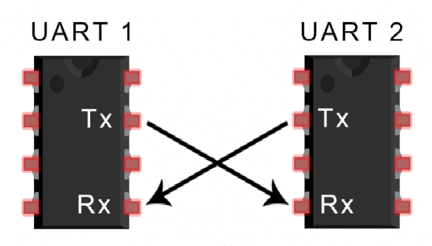
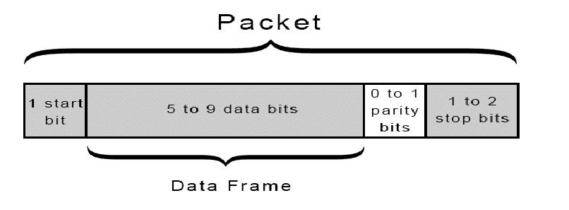
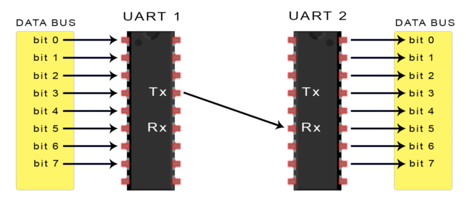
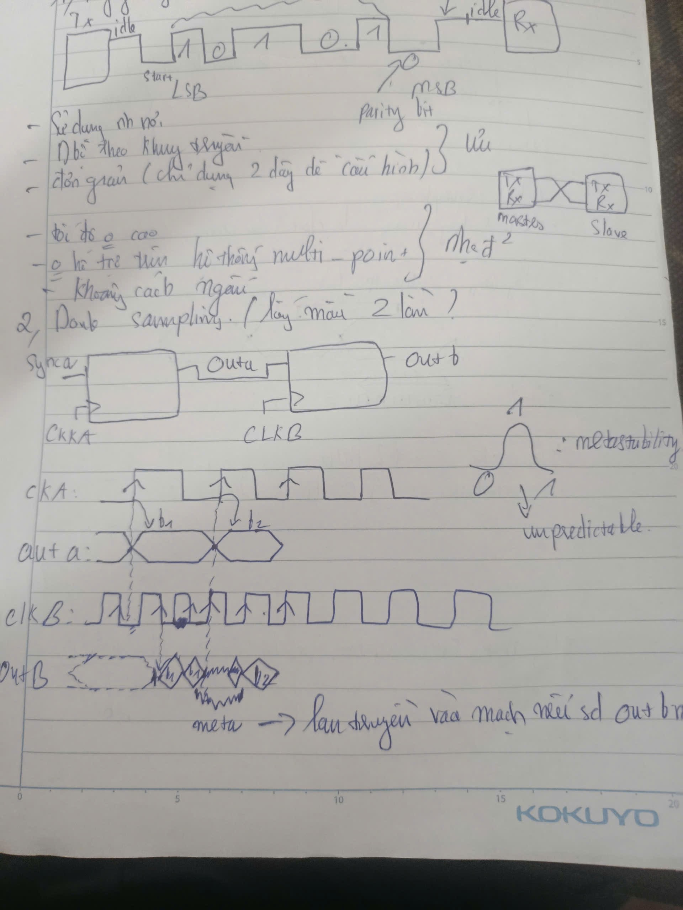
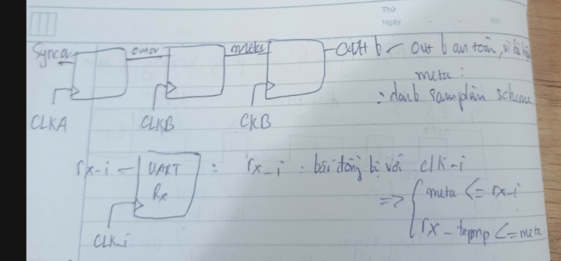
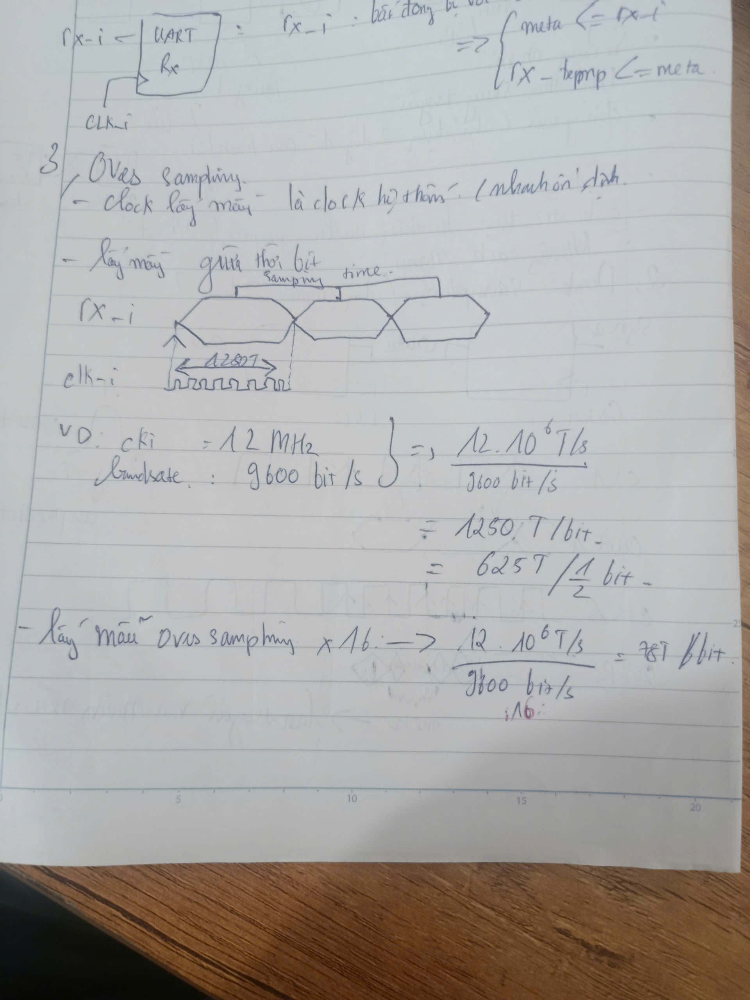
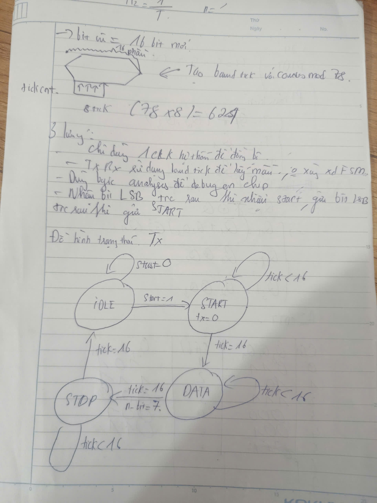

# Tìm hiểu và thực hành UART

## Mục lục

- [A. Kiến thức UART](#a-kiến-thức-uart)
  - [1. UART](#1-uart-universal-asynchronous-receiver-transmitter)
  - [2. Double sampling](#2-double-sampling)
  - [3. Oversampling](#3-oversampling)
- [B. Bài tập thực hành](#b-bài-tập-thực-hành)
  - [1. Thiết kế các module UART](#1-thiết-kế-các-module-uart)
  - [2. Giao tiếp ESP32 với Tang Nano 9K](#2-giao-tiếp-esp32-với-tang-nano-9k)

## A. Kiến thức UART

### 1. UART (Universal Asynchronous Receiver-Transmitter)

UART (Universal Asynchronous Receiver-Transmitter) là giao tiếp nối tiếp không đồng bộ. UART có thể hoạt động ở chế độ song công toàn phần (full duplex), tức là có thể truyền và nhận dữ liệu đồng thời trên hai đường tín hiệu riêng.

#### 1.1. Nguyên lý kết nối



UART sử dụng hai đường tín hiệu chính:

- **TX (Transmit):** chân truyền dữ liệu.
- **RX (Receive):** chân nhận dữ liệu.
- **GND:** nối chung mass giữa hai thiết bị để tạo mức điện áp tham chiếu.

Kết nối chéo TX/RX: TX của thiết bị thứ nhất nối với RX của thiết bị thứ hai và ngược lại.

#### 1.2. Đặc điểm bất đồng bộ (Asynchronous)

UART không có đường xung nhịp (clock) dùng chung giữa hai thiết bị. Hai phía cần cấu hình cùng baud rate và định dạng khung truyền để bên nhận lấy mẫu dữ liệu đúng thời điểm.

- Một số baud rate phổ biến: `9600`, `57600` và `115200`.
- Nếu baud rate giữa hai phía chênh lệch đáng kể, dữ liệu nhận được có thể bị sai.
- **Bit rate** là số bit truyền trong một giây.
- **Baud rate** là số ký hiệu truyền trong một giây. Với UART nhị phân, mỗi ký hiệu biểu diễn một bit nên hai giá trị này thường bằng nhau.

#### 1.3. Cấu trúc khung dữ liệu (Data Frame)

Mỗi byte được truyền trong một khung UART gồm các phần sau:

- **Start bit (1 bit):** mức thấp (`0`), báo hiệu bắt đầu khung.
- **Data bits (thường là 8 bit):** dữ liệu được truyền theo thứ tự bit thấp trước (LSB first).
- **Parity bit (tùy chọn):** hỗ trợ phát hiện một số lỗi truyền dữ liệu.
- **Stop bit (1 hoặc 2 bit):** mức cao (`1`), báo hiệu kết thúc khung.





### 2. Double sampling





### 3. Oversampling





## B. Bài tập thực hành

### 1. Thiết kế các module UART

Đã thực hiện các module phát (TX), nhận (RX) và tạo baud rate (`baud_gen`).

### 2. Giao tiếp ESP32 với Tang Nano 9K

[Video minh họa](https://drive.google.com/drive/folders/1XZgoENMQcPuuqVvY2_9DZhsLycaGjnLz?usp=sharing)

#### 2.1. Chương trình ESP32 phát dữ liệu

ESP32 gửi ký tự ASCII `'1'` và `'0'` qua UART2 để bật hoặc tắt LED trên FPGA.

```cpp
// Khai báo chân UART2 trên ESP32
#define RXD2 16
#define TXD2 17

void setup() {
  // Serial Debug máy tính
  Serial.begin(9600);
  
  // Serial2 giao tiếp với Tang Nano 9K (Baudrate 9600)
  Serial2.begin(9600, SERIAL_8N1, RXD2, TXD2);
  
  Serial.println("ESP32 UART Ready!");
}

void loop() {
  // Gửi lệnh BẬT LED (Ký tự '1')
  Serial.println("Gui lenh: BAT LED");
  Serial2.write('1');
  delay(2000); // Chờ 2 giây

  // Gửi lệnh TẮT LED (Ký tự '0')
  Serial.println("Gui lenh: TAT LED");
  Serial2.write('0');
  delay(2000); // Chờ 2 giây
}
```

#### 2.2. Module UART RX và điều khiển LED trên Tang Nano 9K

```verilog
module baud_rate_generator (
    input clk,          // Clock hệ thống (27MHz)
    input reset,        // Reset tích cực cao
    output reg tick     // Xung tick cho Rx và Tx (gấp 16 lần Baud rate)
  );

  reg [7:0] counter; // 27MHz / (9600 * 16) = 175.78

  always @(posedge clk or posedge reset)
  begin
    if (reset)
    begin
      counter <= 0;
      tick <= 0;
    end
    else
    begin
      if (counter == 175)
      begin // Đếm từ 0 đến 175 là 176 chu kỳ
        counter <= 0;
        tick <= 1;
      end
      else
      begin
        counter <= counter + 1;
        tick <= 0;
      end
    end
  end
endmodule


module uart_rx (
    input clk,
    input reset,
    input rx,               // Chân Rx nối tiếp đầu vào
    input tick,             // Xung từ bộ Baud Rate Gen
    output reg rx_done_tick,// Báo hiệu đã nhận xong 1 byte
    output [7:0] dout       // Dữ liệu 8-bit đầu ra song song
  );

  localparam [1:0] IDLE  = 2'b00,
             START = 2'b01,
             DATA  = 2'b10,
             STOP  = 2'b11;

  reg [1:0] state_reg, state_next;
  reg [3:0] s_reg, s_next;       // Đếm tick (0-15)
  reg [2:0] n_reg, n_next;       // Đếm bit nhận (0-7)
  reg [7:0] d_reg, d_next;       // Thanh ghi lưu dữ liệu đang dịch vào

  always @(posedge clk or posedge reset)
  begin
    if (reset)
    begin
      state_reg <= IDLE;
      s_reg <= 0;
      n_reg <= 0;
      d_reg <= 0;
    end
    else
    begin
      state_reg <= state_next;
      s_reg <= s_next;
      n_reg <= n_next;
      d_reg <= d_next;
    end
  end

  always @*
  begin
    state_next = state_reg;
    s_next = s_reg;
    n_next = n_reg;
    d_next = d_reg;
    rx_done_tick = 1'b0;

    case (state_reg)
      IDLE:
      begin
        if (~rx)
        begin // Phát hiện cạnh xuống (Bit Start)
          state_next = START;
          s_next = 0;
        end
      end

      START:
      begin
        if (tick)
        begin
          if (s_reg == 7)
          begin // Lấy mẫu ở GIỮA bit Start
            state_next = DATA;
            s_next = 0;
            n_next = 0;
          end
          else
          begin
            s_next = s_reg + 1;
          end
        end
      end

      DATA:
      begin
        if (tick)
        begin
          if (s_reg == 15)
          begin // Lấy mẫu ở GIỮA bit dữ liệu (cứ sau mỗi 16 ticks)
            s_next = 0;
            d_next = {rx, d_reg[7:1]}; // Dịch bit nhận được vào MSB
            if (n_reg == 7)
              state_next = STOP;
            else
              n_next = n_reg + 1;
          end
          else
          begin
            s_next = s_reg + 1;
          end
        end
      end

      STOP:
      begin
        if (tick)
        begin
          if (s_reg == 15)
          begin // Đợi hết bit Stop
            state_next = IDLE;
            rx_done_tick = 1'b1; // Báo nhận thành công
          end
          else
          begin
            s_next = s_reg + 1;
          end
        end
      end
    endcase
  end

  assign dout = d_reg;
endmodule


module top (
    input wire clk,          // Clock 27MHz 
    input wire rst_n,        // Nút nhấn Reset S2 (Chân 4 - Tích cực mức thấp)
    input wire uart_rx_pin,  // Chân RX nhận từ ESP32 (Ví dụ: Chân 25)
    output reg [5:0] led     // 6 LED onboard (Mức 0 = SÁNG)
);

  wire reset = ~rst_n;

  wire tick;
  wire rx_done;
  wire [7:0] rx_data;

  // 1. Khởi tạo Baud Rate Generator
  baud_rate_generator u_baud_gen (
      .clk(clk),
      .reset(reset),
      .tick(tick)
  );

  // 2. Khởi tạo UART Receiver
  uart_rx u_uart_rx (
      .clk(clk),
      .reset(reset),
      .rx(uart_rx_pin),
      .tick(tick),
      .rx_done_tick(rx_done),
      .dout(rx_data)
  );

  // 3. Logic điều khiển LED dựa trên dữ liệu nhận được
  always @(posedge clk or posedge reset) begin
    if (reset) begin
      led <= 6'b111111; // Reset -> Tắt toàn bộ LED (mức 1 = Tắt)
    end else if (rx_done) begin
      if (rx_data == 8'h31) begin       // Mã ASCII '1' (0x31) -> BẬT LED
        led <= 6'b000000;             // Sáng toàn bộ LED (mức 0 = Sáng)
      end else if (rx_data == 8'h30) begin // Mã ASCII '0' (0x30) -> TẮT LED
        led <= 6'b111111;             // Tắt toàn bộ LED
      end
    end
  end

endmodule
```

#### 2.3. Ràng buộc chân (CST)

```text
//Copyright (C)2014-2025 Gowin Semiconductor Corporation.
//All rights reserved. 
//File Title: Physical Constraints file
//Tool Version: V1.9.11.03 Education
//Part Number: GW1NR-LV9QN88PC6/I5
//Device: GW1NR-9
//Device Version: C
//Created Time: Thu 07 30 08:17:02 2026

IO_LOC "led[5]" 16;
IO_PORT "led[5]" IO_TYPE=LVCMOS18 PULL_MODE=UP DRIVE=8 BANK_VCCIO=1.8;
IO_LOC "led[4]" 15;
IO_PORT "led[4]" IO_TYPE=LVCMOS18 PULL_MODE=UP DRIVE=8 BANK_VCCIO=1.8;
IO_LOC "led[3]" 14;
IO_PORT "led[3]" IO_TYPE=LVCMOS18 PULL_MODE=UP DRIVE=8 BANK_VCCIO=1.8;
IO_LOC "led[2]" 13;
IO_PORT "led[2]" IO_TYPE=LVCMOS18 PULL_MODE=UP DRIVE=8 BANK_VCCIO=1.8;
IO_LOC "led[1]" 11;
IO_PORT "led[1]" IO_TYPE=LVCMOS18 PULL_MODE=UP DRIVE=8 BANK_VCCIO=1.8;
IO_LOC "led[0]" 10;
IO_PORT "led[0]" IO_TYPE=LVCMOS18 PULL_MODE=UP DRIVE=8 BANK_VCCIO=1.8;
IO_LOC "uart_rx_pin" 25;
IO_PORT "uart_rx_pin" IO_TYPE=LVCMOS18 PULL_MODE=UP BANK_VCCIO=1.8;
IO_LOC "rst_n" 4;
IO_PORT "rst_n" IO_TYPE=LVCMOS18 PULL_MODE=UP BANK_VCCIO=1.8;
IO_LOC "clk" 52;
IO_PORT "clk" IO_TYPE=LVCMOS18 PULL_MODE=UP BANK_VCCIO=1.8;

```
